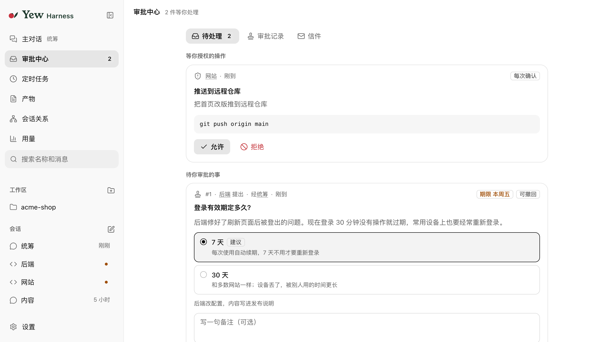
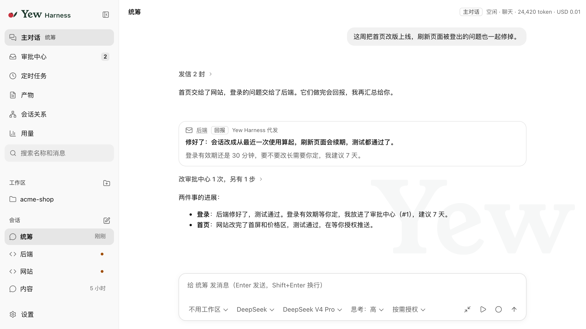
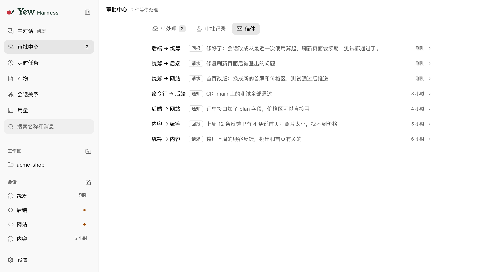
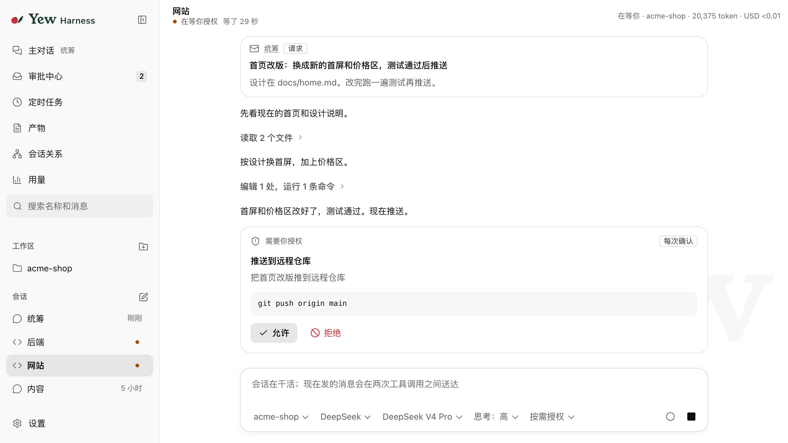
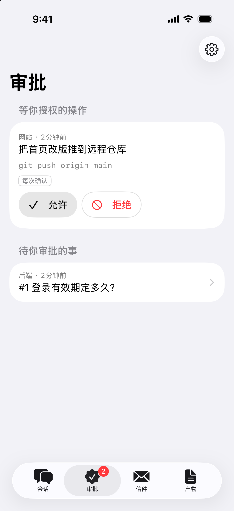
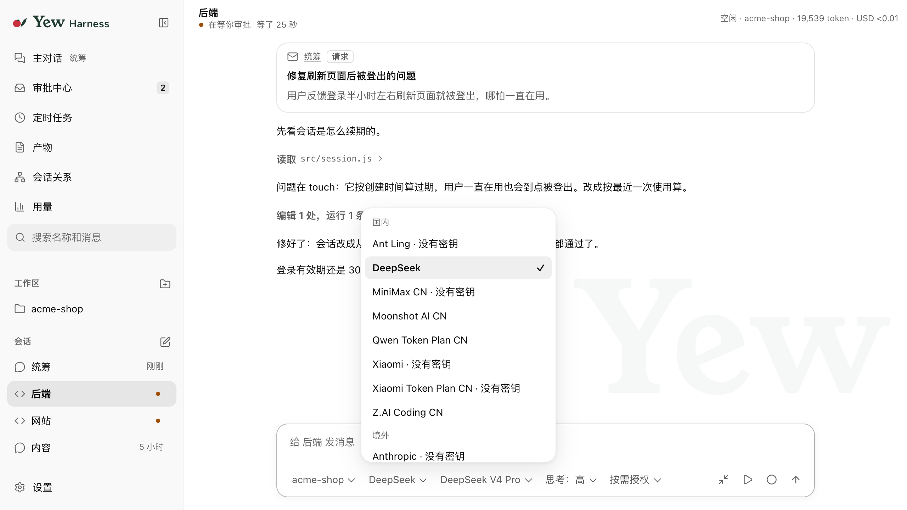

  

<h1 align="center">Yew Harness</h1>

AI 原生的多 Agent 工作台

  <a href="README.md">English</a> · <strong>简体中文</strong>

  
  
  
  

<picture>
  <source media="(prefers-color-scheme: dark)" srcset="docs/assets/yew-approval-zh-dark.png">
  
</picture>

按 Session Engineering 的做法组织 Agent 会话：你只对接主对话，要你授权和决定的事都汇到审批中心。

每个会话有名字、职责、工作区、模型和权限，按团队组织：常设会话长期负责一块事，任务会话为一件事开设，做完回报，之后可以归档。会话之间用信件分派和回报。会话跑在你电脑上的 Yew Harness 服务里，网页关了也照常干活。

Yew Harness 以 MIT 许可证开源，当前版本 1.6.1。能做什么见[更新记录](CHANGELOG.md)，为什么这样做见[产品蓝图](docs/blueprint.md)。iPhone 应用的源码在 `ios/`，还没有上架；安卓版的源码在 `android/`，安装包见下面的[手机端](#手机端)。

## 为 Session Engineering 而生

按这套理念构建，并且处处为它优化。

<picture>
  <source media="(prefers-color-scheme: dark)" srcset="docs/assets/yew-main-zh-dark.png">
  
</picture>

## 出色的多 Agent 协作体验

基于异步信箱机制 A2A，让 Agent 交流很无感。

<picture>
  <source media="(prefers-color-scheme: dark)" srcset="docs/assets/yew-letters-zh-dark.png">
  
</picture>

## 真正坐进办公室当老板

授权与决定都在审批中心，你的操作才有实权。

<picture>
  <source media="(prefers-color-scheme: dark)" srcset="docs/assets/yew-permission-zh-dark.png">
  
</picture>

## 随时随地，打破工位枷锁

手机也能审批，人不在电脑前，授权和决定照样处理。

  <picture>
    <source media="(prefers-color-scheme: dark)" srcset="docs/assets/yew-phone-zh-dark.png">
    
  </picture>

## 模型随你选

接入库用开源的 pi-ai，支持超级多家模型服务商。

<picture>
  <source media="(prefers-color-scheme: dark)" srcset="docs/assets/yew-models-zh-dark.png">
  
</picture>

## 快速开始

需要 macOS 或 Linux、Node.js 24 或更高版本和 ripgrep（macOS：`brew install ripgrep`）；Linux 上还要 bubblewrap 和 socat（Debian、Ubuntu：`sudo apt install ripgrep bubblewrap socat`）。Windows 请在 WSL 里使用。

1. 安装：`npm install -g @tenonai/yew`。
2. 存入一个模型服务商的 API Key（默认服务商是 DeepSeek）：`yew key set deepseek`。Key 只存进系统钥匙串。
3. 启动服务：`yew serve --open`，浏览器会打开网页界面。以后需要新的登录链接，运行 `yew open`。
4. 可选：`yew service install` 让 Yew Harness 登录后自动启动；macOS 上 `yew app install` 在「应用程序」里放一个 Yew Harness 图标。

从源码运行：克隆仓库后 `npm install`、`npm run build:web`、`npm link`。

## 手机端

手机上的 Yew Harness 只连接你自己电脑上的 Yew Harness：在电脑上显示二维码，手机扫码配对，之后在手机上看会话、处理审批中心里的事。两端经中继通信，内容端到端加密；默认用 Tenon AI 运行的中继，也可以自己部署（见 `relay/`）。

- 安卓：安装包（apk）在 [GitHub](https://github.com/dozybot001/Yew/releases) 和 [Gitee](https://gitee.com/dozybot/yew/releases) 的 Releases 里，由长沙榫卯人工智能科技有限公司签名。签名证书的 SHA-256 指纹是 `9F:F5:6E:EA:A8:3C:DC:01:BA:66:D8:79:23:9C:DE:5A:2A:69:C3:AE:D2:60:5C:D8:E1:B9:34:8D:BF:28:61:B2`；这个指纹也公布在[官网的 Yew Harness 页面](https://tenonai.cn/zh/products/yew/#android)上，可以对照；每个版本的说明里有安装包的 SHA-256。更新时系统如果提示签名不一致，不要安装。
- iPhone：还没有上架，之后经 TestFlight 和 App Store 发布。

## 文档

- [产品蓝图](docs/blueprint.md)：为什么做、做什么、不做什么、怎么验收
- [对外介绍](docs/introduction.md)：官网、商店和各渠道介绍 Yew Harness 时用的定义、简介和能写的能力
- 实现计划：[M1](docs/archive/m1-plan.md)、[M2](docs/archive/m2-plan.md)、[M3](docs/archive/m3-plan.md)
- [可借鉴的开源项目](docs/prior-art.md)
- [数据清单](docs/data-inventory.md)：Yew Harness 在你电脑上存了哪些数据、怎么删除
- [iPhone 应用上架](docs/app-store.md)：商店里填什么、进度
- [更新记录](CHANGELOG.md)
- [开发约定](AGENTS.md)

## 数据去向

Yew Harness 不收集任何数据，也不含统计、遥测或上报代码。会话、消息和设置存在你自己的电脑上，API Key 存在系统钥匙串里。你选用的模型服务商会收到发给它的对话内容，这部分适用该服务商的隐私政策。

## 安全

会话的命令和你自己加的 MCP 服务器在系统沙箱里运行。沙箱用的是 Anthropic 开源的 [sandbox-runtime](https://github.com/anthropics/sandbox-runtime)（Apache-2.0），macOS 上底层是系统的 Seatbelt，Linux 上是 bubblewrap。在沙箱里：

- 读写不了 Yew Harness 的数据目录（里面有你的决定、登录令牌和日志），也读不到钥匙串里的条目；
- 只能写会话的工作区、临时文件夹和沙箱自己的缓存，写不了 `~/.zshrc`、`~/.gitconfig` 这类文件，也写不了仓库的钩子和配置；
- 改不了 Yew Harness 的程序和开机启动项，连不上它的本机端口，也连不上别的本机端口和局域网；
- 联网只放行常用的包管理源、GitHub、Gitee 和配了密钥的模型服务商，连别的网站时先问你；
- 读不到 `~/.ssh`、`~/.aws`、`~/.netrc` 这类凭据文件，也用不了 ssh-agent，除非你在设置的「启动」里打开；
- 读不到你在「默认设置 → 会话读不到的目录」里列的文件夹，会话的文件工具也读不到；
- Linux 上连不上本机的 Unix 套接字，包括 D-Bus 会话总线。

Linux 上，命令运行中新建的仓库在命令结束前不受保护；命令结束后 Yew Harness 把新出现的钩子挪开，不让 git 执行，并在命令的输出里写明。

要在沙箱外跑的命令（比如要用钥匙串里凭据的 `git push`、新建或克隆仓库、要监听本机端口的开发服务器、Xcode 构建），每次都先问你；在外面跑的 git 不执行仓库里的钩子。自带的浏览器和电脑操控不进沙箱：浏览器只能访问它自己的空文件夹，打不开 `file://` 网页，也连不上 Yew Harness 的端口。从源码目录运行 Yew Harness 时，这个目录在沙箱里写不了，要用 Yew Harness 改 Yew Harness，请运行 npm 安装的版本。

沙箱起不来时，Yew Harness 不进沙箱照常运行，并在 `yew serve` 的输出和设置的「启动」里写明原因：缺少要用的程序（macOS 要 ripgrep，Linux 要 bubblewrap、socat 和 ripgrep），系统不让 bubblewrap 建用户命名空间（比如 Ubuntu 24.04 起的默认设置，放开的办法见 sandbox-runtime 的说明），或起 `yew serve` 时设了 `YEW_SANDBOX=off`。这时按需授权和完全授权下，会话不问就跑的命令以你的系统账户运行，能做你在终端里能做的事，包括改 Yew Harness 自己的记录（决定和授权也在里面）、读它保存的 API Key。Linux 上的沙箱在 Debian 12 的容器里跑过日常的测试，还没在实机上测过。

别的会话的信、网页、邮件和 MCP 返回的内容，Yew Harness 只当作数据，不能替你授权；会话要处理这类外来内容时，仍建议给它用逐项授权，让命令每次都先问你。

报告安全问题见 [SECURITY.md](SECURITY.md)。

## 参与贡献

欢迎提 issue 和 pull request，做法见 [CONTRIBUTING.md](CONTRIBUTING.md) 和[行为准则](CODE_OF_CONDUCT.md)。

## 许可证

[MIT](LICENSE)。Copyright (c) 2026 Changsha Tenon Artificial Intelligence Technology Co., Ltd.（长沙榫卯人工智能科技有限公司）

运行时依赖和网页界面里用到的第三方包见 [THIRD-PARTY-NOTICES.md](THIRD-PARTY-NOTICES.md)。

名称、标志和角色：Yew Harness、Yew 和榫卯 Tenon 的名称和标志（包括 `web/public/icons/`、`ios/Yew/Assets.xcassets/` 里的图标），以及角色 Yew 的形象和图片（包括 `web/public/mascot/`、`android/app/src/main/res/drawable-nodpi/` 里的图片和 `ios/Yew/Assets.xcassets/` 里 Mascot 开头的图片），不在 MIT 许可证的授权范围内。你可以照原样提到这些名称，说明你在使用 Yew Harness 或基于它修改；但不要把这些名称和标志用作你自己产品的名称或标志，不要在你自己的产品里使用 Yew 的形象和图片，也不要让人以为你的产品来自榫卯 Tenon AI 或得到它的认可。

---

  出品方　<a href="https://tenonai.cn/"> 榫卯 Tenon AI</a>

