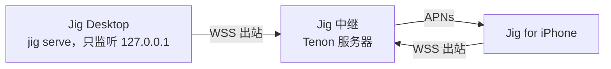

# Jig M3 实现计划

版本 0.2（2026-11-09）。依据[产品蓝图](blueprint.md) 0.26 第六（6.1 第 1、6 条，6.5，6.7）、八、九、十一节，以及 [M2 实现计划](m2-plan.md)第十三节挪到 M3 的内容；第二节的决定待创始人确认。技术栈和开发约定见 [AGENTS.md](../AGENTS.md)。

## 一、范围与验收

- **范围**：iPhone 应用；经中继连接电脑上的 Jig（端到端加密）与扫码配对；推送；手机上处理审批中心；定时任务；开机启动；费用上限与提醒。产物、导入说明和技能、MCP 客户端、联网搜索、数据导出在 M4。
- **验收**（蓝图第十一节）：离开电脑、手机不在同一网络时，在 iPhone 应用里授权一次操作、回复一个会话、处理一张决定卡；一个定时任务按时运行，结果回报给它的团队。步骤见第十二节。通过后发布 0.3.0，iPhone 应用先走 TestFlight。
- **原则**：按蓝图第四节第 8 条，加密、推送时机、无人值守、补跑、上限都由代码保证，不写成给模型的规矩。

## 二、架构

- **三个部分**：电脑上的 Jig（Jig Desktop）、Tenon 部署的中继、iPhone 应用。电脑和手机都主动连中继，电脑不开端口，两端不需要在同一网络。
- **中继只转发密文**：两端之间端到端加密，中继按「电脑 id」把两条连接接起来，转发帧，不存内容、不解密；只看得到连接时间、流量大小和推送用的设备令牌。代码开源，也可以自己部署（设置里改中继地址）。
- **手机用的是电脑上同一套接口**：手机发出的请求经加密通道到达电脑，由 Jig 交给本机的接口处理，返回结果；事件流（SSE）也走这条通道。手机端不另起一套业务逻辑。

## 三、待创始人确认的决定

| 决定 | 建议 | 备选 |
| --- | --- | --- |
| 1. 通知里写什么 | 写一句具体内容，如「UI 在等你授权：推送到远程仓库」。内容在电脑上加密，经中继和 APNs 送到手机，由应用在手机上解密后显示，中继和苹果都读不到 | 只写「Jig：3 件等你处理」 |
| 2. 中继部署在哪 | 国内一台现有的 Tenon 服务器，子域名如 `relay.tenonai.cn`；域名解析和证书由安全组配，首次上线由你批准 | 香港或海外服务器（不用备案，国内连接稍慢） |
| 3. 定时任务的结果回报给谁 | 回报给主对话（由它汇总给你），同时推送；没有主对话时只推送 | 只推送和记在定时任务列表里 |
| 4. 定时任务怎么运行 | 按时给团队里一个常设会话寄一封信，沿用它的上下文和职责（蓝图第四节第 1 条）；这次运行可以单独设授权方式 | 每次开一个新的任务会话，跑完自动归档 |
| 5. 费用上限 | 每个会话可设每日上限，设置里另有全局每日上限；到 80% 推送提醒，到上限停下并推送 | 只提醒不停 |

## 四、端到端加密与配对

- **密钥**：电脑上的 Jig 有一对长期密钥（X25519），私钥存系统钥匙串；每台 iPhone 有自己的一对，私钥存 iOS 钥匙串（仅本机，不随 iCloud 同步）。
- **配对**：电脑上「设置 → 设备 → 添加 iPhone」显示二维码，内容是中继地址、电脑 id、电脑公钥和一次性配对密钥（5 分钟有效）。iPhone 应用扫码后经中继发出配对请求（带自己的公钥，用配对密钥认证），电脑核对后记下这台设备；配对密钥用过即失效。
- **每次连接**：两端用各自的长期密钥做 Noise IK 握手，得到本次的会话密钥（ChaCha20-Poly1305）；中继在中间看不到明文，也冒充不了任何一端。电脑只接受已配对设备的握手。
- **设备列表**：设置里列出设备、最近连接时间，可以改名、关推送、撤销；撤销后这台设备立即断开，不能再握手。
- **只能在电脑上做**：服务商与 API Key、添加和撤销设备、改中继地址。其余手机上都能做。
- 加密用经过审计的实现：电脑端用 Node 的 `crypto`（X25519、HKDF、ChaCha20-Poly1305），iPhone 用 CryptoKit；握手按 Noise 协议规范实现，两端用同一组测试向量。

## 五、中继服务

- TypeScript（Node 24），在仓库的 `relay/`；只做三件事：接受电脑和手机的 WSS 连接并按电脑 id 配对转发；转发配对请求；替电脑发 APNs 推送。
- 电脑连接时用自己的私钥签名证明是这个电脑 id；同一电脑 id 只保留最新的一条连接。手机连接时只说明要找哪个电脑 id，身份由端到端握手确认。
- 限流：每个连接的帧率和流量有上限；单帧不超过 1 MB；空闲连接定时心跳。
- 不写内容日志；访问日志只记连接时间、电脑 id 的哈希、流量大小，按规范 15.5 保存。
- APNs 的密钥（.p8）存在中继服务器上，按服务器部署规范作为密钥管理，不进仓库。
- 按 `~/memory/server-deployment.md` 部署：本地构建不可变的发布包、上传、候选槽、切流和回滚；域名解析与证书由安全组负责（会话分工 2.1）。

## 六、电脑上的 Jig

- 设置里「允许手机访问」打开后，`jig serve` 连上中继并保持连接，断线自动重连（指数退避）；关掉就断开。命令行有 `jig remote on|off|status`。
- 来自手机的请求在电脑上走和网页一样的接口，带上设备身份；本机网页的 Cookie 校验不变。
- 手机通道上的事件流和网页的一致，断线重连后从上次的序号继续。

## 七、iPhone 应用

- **工程**：`ios/`，Swift 6、SwiftUI，iOS 17 起，Bundle ID `cn.tenonai.apps.jig`，只支持 iPhone；文案用 String Catalog，中英双语跟随系统和「按应用设置语言」；深浅色跟随系统；隐私清单 `PrivacyInfo.xcprivacy`（规范 17.8）。
- **界面**：底部三个入口：会话、审批、信件（产物在 M4 加）。
  - 会话：列表（团队、状态点、未读、置顶），点进去是会话记录和输入框；能停止、继续、改设置。
  - 审批：待处理（授权卡、提问卡、决定卡、待放行的信）、审批记录；卡片结构和电脑端一致。
  - 信件：所有往来，一行一封，点开看全文。
  - 设置（右上角）：配对状态、通知、关于（版本、出品方、官网、隐私政策和用户协议）。
- **未配对时**：首页说明 Jig 是什么、在电脑上怎么打开「添加 iPhone」，下面是扫码按钮；App Store 审核用内置的演示数据浏览界面（审核说明里写明），不需要账号。
- **规范**：点击热区不小于 44pt（5.8），支持动态字体和 VoiceOver（18.3、18.4），减弱动态效果（4.6）。
- **开发**：先用只在 Debug 版里有的「直连本机」方式（模拟器访问本机 `jig serve`）做界面，再接上中继通道。

## 八、推送

- **APNs**：iPhone 应用在配对后申请通知权限，把设备令牌经加密通道交给电脑；电脑决定推什么，把通知内容用这台设备的密钥加密，交给中继转发到 APNs；应用里的通知服务扩展（Notification Service Extension）在手机上解密后显示（决定 1）。
- **推什么**（蓝图 6.7 第 20 条）：审批中心新增的待办（授权、提问、决定卡、待放行的信），会话出错或待核对，任务会话和定时任务完成，费用到 80% 和到上限。
- **怎么推**：10 秒内的多条合成一条；你在电脑前（电脑上的 Jig 页面在前台、2 分钟内有过操作）先不推，离开后还没处理的再推；点通知打开对应的卡片或会话；处理掉的待办，手机上的通知随之撤下；角标是审批中心的待办数。

## 九、定时任务

- **是什么**（决定 4）：按时寄给一个常设会话的一封信。字段：名称、时间（cron，5 段，本机时区）、目标会话、信的内容、这次运行的授权方式（默认沿用会话的）、错过时补跑或跳过、开关。任务属于目标会话所在的团队。
- **到点**：Jig 以「定时任务「名称」」的名义寄一封请求，会话照常干活，这一轮的回复按决定 3 回报，并推送「定时任务「名称」完成」。
- **无人值守**（蓝图 6.1 第 6 条）：定时任务开始的这一轮，遇到要问你的操作直接拒绝，工具结果写明「无人值守，已拒绝」，回报里列出被拒的操作，并推送给你。这期间你给会话发了消息，这一轮就不再算无人值守。
- **错过与重叠**：Jig 没运行或电脑睡眠时错过的时间，下次启动或唤醒后按设置补跑一次或跳过；上一轮还没结束，这一次跳过并记下原因。
- **管理**：电脑和手机上都有「定时任务」页面（列表、下次运行、最近结果，新建和编辑；常用时间可选，也可以直接写 cron，旁边写出下三次运行时间）；`manage_jig` 能建、改、停用（新建和改动属「改设置」，这次运行的授权方式比目标会话宽属「放宽」）；`jig schedule list|run <名称>`。
- **cron** 自己解析（分、时、日、月、周，支持 `*` `,` `-` `/`），不加依赖。

## 十、开机启动、费用上限

- **开机启动**：`jig service install|uninstall|status`。macOS 用用户级 LaunchAgent，登录后启动 `jig serve`，异常退出自动拉起，日志写 `~/.jig/logs`；Linux 用 `systemd --user`。只在你运行这条命令时改系统配置；开机启动时不打开浏览器。手机要随时连得上，电脑上的 Jig 得一直开着，所以这一项和中继一起做。
- **费用上限**（决定 5）：每个会话可设每日上限（美元，按服务商价格估算），设置里另有全局每日上限；到 80% 推送提醒，到上限这个会话停下（和你点停止一样），记下原因并推送，你点继续或调高上限后恢复。定时任务的运行也算在内；没有价格的模型只记 token。

## 十一、数据、接口与命令行

- **迁移 5**：`devices`（名称、公钥、APNs 设备令牌、是否推送、配对时间、最近连接时间），`schedules`（第九节的字段与上次运行结果），`letters.schedule_id`，`usage_daily`（每个会话每天的 token 和费用）。会话选项加每日费用上限；设置加中继地址、「允许手机访问」、全局每日费用上限。电脑的长期私钥存系统钥匙串。
- **接口**：`POST /api/devices/pairing`（只限本机，生成二维码内容）、`GET /api/devices`、`PATCH /api/devices/:id`、`DELETE /api/devices/:id`（只限本机）；`GET|POST /api/schedules`、`PATCH|DELETE /api/schedules/:id`、`POST /api/schedules/:id/run`。事件流加设备和定时任务的变化。
- **命令行**：`jig remote on|off|status`、`jig schedule list|run`、`jig service install|uninstall|status`，都有 `--help`，供程序读取的有 `--json`。
- [数据清单](data-inventory.md)和隐私说明补上：设备与推送令牌、定时任务、每日用量；中继看得到的元数据（连接时间、流量、推送令牌）和看不到的内容。

## 十二、开发顺序

每一步带测试，`npm run check` 通过后提交并推送；iOS 用 `xcodebuild test` 在模拟器上跑。测试里不调用真实模型，不连真实的中继、APNs 和 launchd（用替身）。

1. **iPhone 应用骨架**：工程、三个入口、直连本机的开发通道、会话列表和会话记录。
2. **协议**：Noise IK 握手、帧格式、请求和事件流的封装；电脑端和 iOS 端用同一组测试向量。
3. **中继服务**：连接、配对转发、限流、APNs 转发；本机测试，再按部署规范上线（首次上线由创始人批准）。
4. **电脑端接入**：连中继、配对、设备列表、经通道处理请求和事件流、`jig remote`。
5. **iPhone 应用完成**：扫码配对、经中继的通道、审批中心、信件、设置、演示数据。
6. **推送**：设备令牌、加密通知、通知服务扩展、推什么和怎么推。
7. **定时任务**。
8. **开机启动、费用上限**。
9. **验收**：按第十三节走一遍；通过后更新 CHANGELOG.md，发布 0.3.0，iPhone 应用上 TestFlight。

## 十三、验收步骤

1. 电脑上打开「允许手机访问」，「添加 iPhone」；iPhone 应用扫码配对，打开通知。
2. 手机关掉 Wi-Fi 用蜂窝网络（不在同一网络）。
3. 在手机上让一个代码会话做一件要授权的事（如推送）→ 手机收到推送 → 在手机上授权。
4. 在手机上回复一个会话。
5. 让一个会话发请求给主对话，主对话放一张决定卡 → 手机收到推送 → 在手机上处理决定卡。
6. 建一个两分钟后运行的定时任务 → 按时运行，结果回报给主对话，手机收到完成推送。

## 十四、M3 不做

| 内容 | 放在 |
| --- | --- |
| 产物、导入现有说明和技能、MCP 客户端、联网搜索、数据导出 | M4 |
| App Store 正式上架（中国大陆需先完成 App 备案，规范 17.9） | M4 前后，由创始人决定 |
| Android 应用、手机网页版 | 不做（蓝图第十节） |
| Tailscale 等私有网络接入 | 不做：中继已覆盖；自己部署中继即可不经 Tenon |

## 修改记录

- **0.2（2026-11-09）** 创始人定：远程访问改用 Tenon 部署的中继（Jig Desktop – 中继 – 手机应用），手机端先做 iPhone 原生应用，不做 PWA（蓝图 0.26）。原决定 2、3（配对方式、Tailscale）由此确定或取消；新增「中继部署在哪」。
- **0.1（2026-11-09）** 起草。
